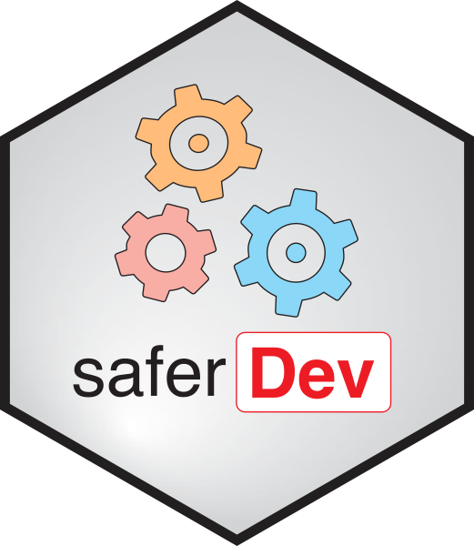

# saferDev [](https://safer-r.github.io/saferDev)[](https://safer-r.github.io/saferDev/)

\

\

## Table of content

- [Description](#description)
- [Content](#content)
- [Versions](#versions)
- [Installation](#installation)
- [Docker](#docker-image)
- [Licence](#licence)
- [Citations](#citations)
- [Credits](#credits)
- [acknowledgments](#acknowledgments)

\

## Description

Set of functions for the development of R functions and pipelines,
written according to the [safer-R project](https://github.com/safer-r)
specifications.

\

## Content

\

Read this [webpage](https://safer-r.github.io/saferDev) for more
details.

\

| Function | Description |
|:---|:---|
| **all_args_here()** | Verify that all the functions used inside a function are written with all their arguments. For instance: `base::paste0(letters[1:2], collapse = NULL, recycle0 = FALSE)` and not `base::paste0(letters[1:2])`. |
| **arg_check()** | Check expected values of arguments of functions: class, type, mode, length (each tested exactly, same values, in the same order), restricted values panel, kind of numeric values in addition to the distinction between ‘integer’ and ‘double’ (proportion only? Inf values authorized? negative values authorized? Integers of type ‘double’?). |
| **colons_check()** | Verify that all the functions used inside a function are all referenced by their package attribution. For instance: [`base::mean()`](https://rdrr.io/r/base/mean.html) and not [`mean()`](https://rdrr.io/r/base/mean.html), or `saferDev:::.base_op_check()` and not [`.base_op_check()`](reference/dot-base_op_check.md). |
| **curl_bracket_check()** | Verify that all the bodies of the `if`, `else`, `for`, `while`, `repeat` and `function` are delimited by curly brackets [`{ }`](https://rdrr.io/r/base/Paren.html). |
| **for_loop_nb_check()** | Verify that the sequence expression of every `for` construct is written with hard numbers (integer-valued numeric literals joined by `:`, or a `seq_len(...)`/`seq_along(...)` call). For instance: `for(i in 1:3)` and not `for(i in 1:length(x))` (use `base::seq_along(x = x)` instead). |
| **env_check()** | Verify that object names in the environment defined by the `pos` argument are identical or not to object names in the above environments (following R Scope). This can be used to verify that names used for objects inside a function or in the working environment do not override names of objects already present in the above R environments, following the R scope. |
| **get_message()** | Return the error, warning or simple (non error non warning) message if ever exist of an instruction written between quotes. |
| **is_function_here()** | Check if required functions are present in installed packages. This controls for instance modifications of function names depending on package versions. |
| **is_package_here()** | Check if required packages are installed locally. |
| **report()** | Print a character string or a data object into a same log file. |
| **true_false_check()** | Verify that the `TRUE` and `FALSE` logical constants are always written in full when used as values (argument values, conditions, comparisons, indexing) and never abbreviated as `T` or `F`. |

\

## Versions

The different *saferDev* releases are tagged
[here](https://github.com/safer-r/saferDev/tags).

\

## Installation

``` r

install.packages("saferDev")
```

Older versions can be installed like this:

``` r

v <- "v1.0.0" # desired tag version
remotes::install_github(paste0("https://github.com/safer-r/saferDev@CRAN_/", v))
```

## Docker image

SaferDev alone in R 4.6.0:
[gmillot/r_v4.6.0_safer_v1.0:gitlab_v11.7](https://hub.docker.com/repository/docker/gmillot/r_v4.6.0_safer_v1.0/general)

SaferDev and [295 other
packages](https://gitlab.pasteur.fr/gmillot/dockerfiles/-/blob/master/R/v4.6.0/extended/v1.0/installed_r_packages.csv)
in R 4.6.0:
[gmillot/r_v4.6.0_extended_v1.0:gitlab_v11.7](https://hub.docker.com/repository/docker/gmillot/r_v4.6.0_extended_v1.0/general)

\

## Licence

This package can be redistributed and/or modified under the terms of the
GNU General Public License as published by the Free Software Foundation,
either version 3 of the License, or (at your option) any later version.
Distributed in the hope that it will be useful, but without any
warranty; without even the implied warranty of merchantability or
fitness for a particular purpose. See the GNU General Public License for
more details at <https://www.gnu.org/licenses> or in the Licence.txt
attached file.

\

## Citation

If you are using functions of *saferDev*, please cite:

> Wang H, Han Y, Legras M, Serizay J, Millot GA (2026). *The R saferDev
> package*. <https://github.com/safer-r/saferDev/>.

\

## Credits

[Haiding Wang](https://github.com/Tintin2710), Bioinformatics and
Biostatistics Hub, Institut Pasteur, Paris, France

[Yushi Han](https://github.com/yushiHn), Bioinformatics and
Biostatistics Hub, Institut Pasteur, Paris, France

[Mia Legras](https://github.com/mialgrs), Bioinformatics and
Biostatistics Hub, Institut Pasteur, Paris, France

[Jacques Serizay](https://github.com/js2264), Spatial Regulation of
Genomes team, Institut Pasteur, Paris, France

[Gael A. Millot](https://github.com/gael-millot), Bioinformatics and
Biostatistics Hub, Institut Pasteur, Paris, France

\

## Acknowledgments

The developers & maintainers of the mentioned softwares and packages,
including:

- [R](https://www.r-project.org/)
- [Git](https://git-scm.com/)
- [GitHub](https://github.com/)
- [rworkflows](https://github.com/neurogenomics/rworkflows)
- [tidyverse](https://ggplot2.tidyverse.org/)
